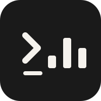
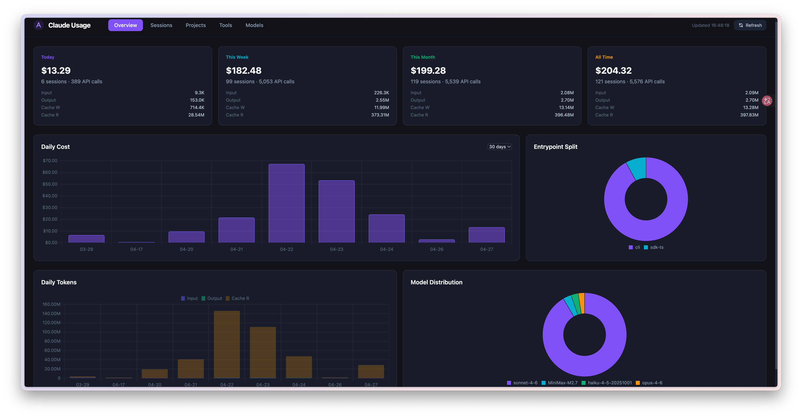
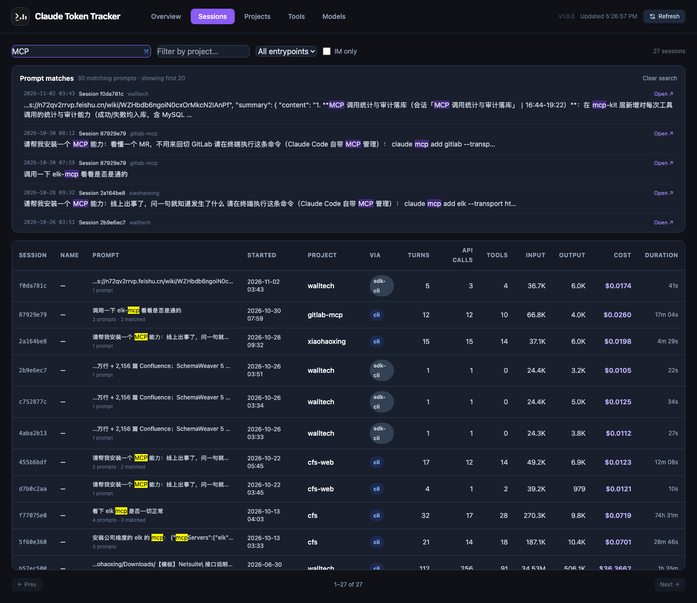
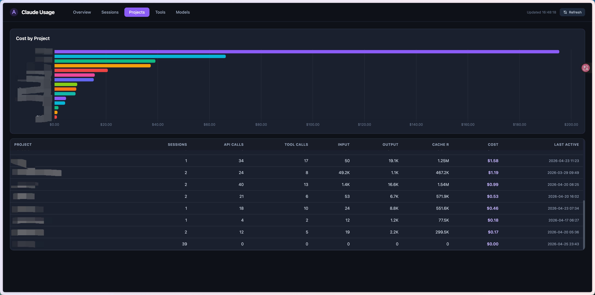
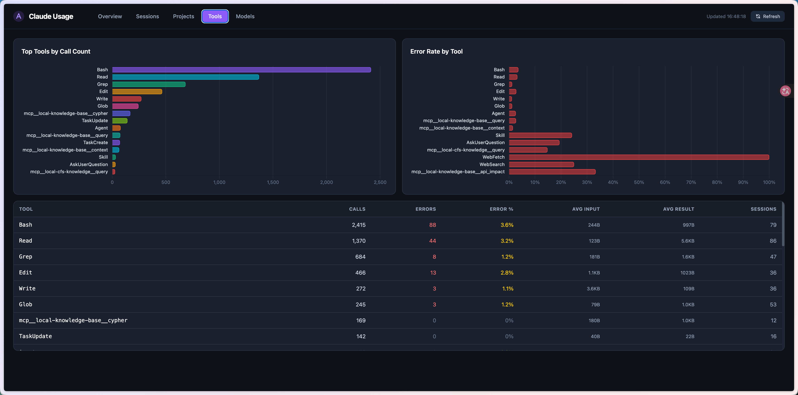
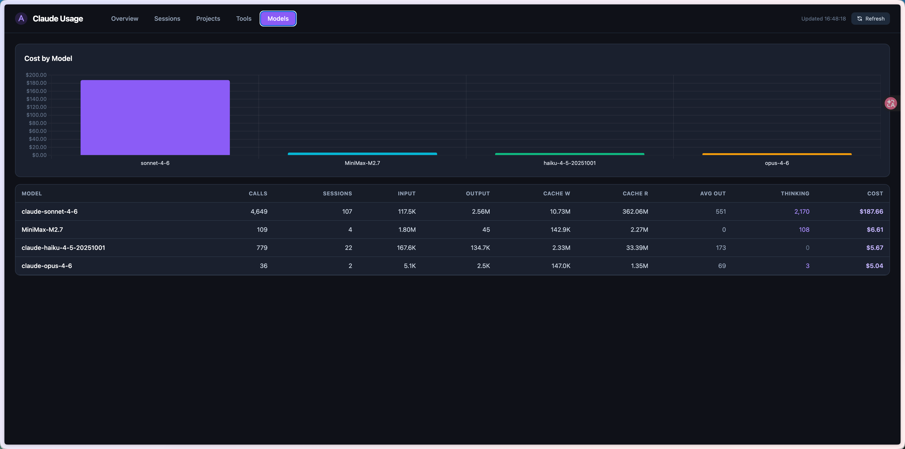

# Claude Token Tracker



> [中文版](README.zh.md)

Track your Claude Code usage — tokens, cost, and sessions — in a local SQLite database, and explore the data through a web dashboard.

## Features

- **Automatic tracking** — a Stop hook records every finished turn; a catch-up
  pass rescans `~/.claude/projects/` so headless/SDK runs and turns that were
  not flushed in time are not lost.
- **Conversation history** — extracts the real user prompts from each transcript
  (tool results, subagent sidechains and injected system content are filtered
  out) and keeps them per session in SQLite.
- **Prompt search** — searches session fields and every stored user prompt.
  Multiple keywords are ANDed; hits show one-line context, and clicking one
  opens the session at that exact question.
- **Dashboard** — Overview, Sessions, Projects, Tools and Models tabs with cost
  trends, token breakdowns, entrypoint/model splits and per-session detail.
- **Cost accounting** — a local `pricing.json` price book with peak/idle tiers,
  multiple currencies and historical repricing after a rate change.
- **CLI & diagnostics** — quick queries with `stats.py`; a shareable, redacted
  report with `tracker.py --doctor`.
- **Versions & upgrades** — releases are git tags; the dashboard detects newer
  tags and can fast-forward/restart itself from the install machine.

## Screenshots











## Prerequisites

- [Claude Code](https://claude.ai/code) installed and configured
- Python 3.7+ — nothing is hardcoded: the hook launcher picks a usable
  interpreter from your `PATH` at run time and reports an error if there is none
- Flask: `pip3 install flask`

## Install

```bash
git clone https://github.com/xiaohaoxing/claude-token-tracker
cd claude-token-tracker
chmod +x install.sh
./install.sh
```

The installer:
1. Finds a usable Python 3 on `PATH` and checks/installs Flask
2. Registers a **Stop hook** in `~/.claude/settings.json` — fires automatically after every Claude Code session
3. Backfills all existing sessions from `~/.claude/projects/`

The registered command is a small portable launcher (`hook.sh`), not a hardcoded
interpreter path, so it keeps working across machines, Python upgrades and
package managers.

After install, new sessions are tracked automatically — no manual steps needed.

The installer accepts a few options:

| Option | Effect |
|--------|--------|
| `--start` | start the dashboard in the background without asking |
| `--no-start` | never start it (scripted / CI installs) |
| `--port N` | dashboard port (default 5001, or `CLAUDE_TRACKER_PORT`) |

When it finishes it prints the dashboard URL, says whether it is already
running, and — in an interactive terminal — offers to start it for you. A
background dashboard logs to `~/.claude/token-tracker/dashboard.log` and writes
its PID to `~/.claude/token-tracker/dashboard.pid`.

## Upgrade

Already installed? Upgrading is one command:

```bash
cd claude-token-tracker
git pull
./install.sh
```

The installer is safe to re-run and does everything for you:

1. Migrates the hook registration to the current portable launcher
   (`python3 …/tracker.py` → `sh …/hook.sh`) and removes the previous entry —
   it prints what it removed, so nothing is changed silently
2. Re-detects a usable Python 3
3. Re-reads every transcript in `~/.claude/projects/`. This also **repairs
   historical sessions**: older versions counted a session's tokens ~2× too
   high, and re-ingesting recalculates them

Nothing has to be migrated by hand — new database tables are created
automatically the first time any part of the tool runs (hook, CLI or dashboard).

Price corrections apply to old data too: the first run after an upgrade
recomputes the cost of every stored API call from `pricing.json` (tokens and
timestamps are kept, only the price changes), so a mispriced model shows its
corrected total immediately instead of only for new sessions. Editing
`pricing.json` later triggers the same pass.

Notes:

- Local changes in the checkout? `git stash && git pull && ./install.sh`
- Installed from a ZIP rather than `git clone`? Download the new ZIP, then run
  `./install.sh` from the new folder — the old hook is removed even though the
  path changed
- Verify afterwards:

```bash
python3 tracker.py --catch-up   # reports the sessions it picked up
python3 stats.py today          # shows today's usage
```

## Troubleshooting

Everything the tool does is logged to `~/.claude/token-tracker/logs/` —
`tracker.log` for the hook and CLI, `dashboard.log` for the web server (including
unhandled request exceptions).

One command turns the current state into a report you can send to support:

```bash
sh hook.sh --doctor                                  # print it
sh hook.sh --doctor --out ~/Desktop/report.txt        # save it
```

`--doctor` still answers when Python itself is the broken thing — `hook.sh`
falls back to a shell-level report in that case. The report contains **no
prompts, messages, transcript contents or credentials**: only versions,
file/schema state, counters and log lines.

What it tells you:

| Symptom | Section to look at |
|---|---|
| nothing is being tracked | `Hook registration`, `Activity` (last hook run, error count) |
| dashboard returns 500s | `Database` (missing columns), `dashboard.log` tail |
| "unsupported Python" | `Runtime`, plus the interpreter list from `hook.sh` |
| data looks stale | `Database` (latest session), `last catch-up`, `Activity` |

## Web Dashboard

```bash
python3 server.py          # → http://localhost:5001
python3 server.py 8080     # custom port
```

Also accessible from other devices on the same LAN: `http://<your-lan-ip>:5001`

**Dashboard tabs:**

| Tab | What you'll see |
|-----|-----------------|
| Overview | Today / week / month / all-time cost cards, daily cost chart, token breakdown chart, entrypoint & model distribution |
| Sessions | Full session list with search/filter, including keyword search over every user prompt; each row previews the question, and clicking a row shows the conversation history plus per-API-call detail |
| Projects | Cost and token usage grouped by project directory |
| Tools | How often each tool was called, error rates, average input/output sizes |
| Models | Per-model token counts and cost |

**Version & one-click upgrade**

Versions are releases, not commits: a version exists only when a
`v<major>.<minor>.<patch>` tag is pushed. The header shows the release you are
running (`v1.0.0`, or `v1.0.0+3` when your checkout carries unreleased commits on
top of it). Commits pushed to `main` between releases are never offered — the
dashboard only moves between tags.

When a newer tag exists, the dashboard says so and — if you are on the install
machine — offers an **Update to `vX.Y.Z`** button. It fast-forwards the checkout
onto that tag (`git merge --ff-only`) and restarts the dashboard in place; the
page reloads itself.

This is deliberately narrow, because the endpoint runs git and restarts a
server that listens on `0.0.0.0`:

- only requests originating on the install machine can upgrade. Visitors from
  the LAN see the version and an "update available" hint, nothing clickable;
- the POST must be JSON and carry a per-process token from `/api/version`,
  which a page on another origin can neither read (no CORS) nor replay
  (a JSON request would need a preflight that fails);
- it refuses dirty worktrees, branches other than `main`, ZIP installs (no
  `.git`), diverged history and local commits that are not part of the release,
  so uncommitted work can never be lost;
- the remote is checked by a background thread, so page loads never wait on the
  network (`git ls-remote` takes a few seconds).

Tunable with `CLAUDE_TRACKER_UPDATE_CHECK=<seconds>` (default 900) and
`CLAUDE_TRACKER_GIT_TIMEOUT=<seconds>` (default 20).

**Cutting a release** (maintainers): land the changes on `main`, then tag that
commit and push the tag — nothing else is needed, the dashboard picks it up on
its next check.

```bash
git tag -a v1.2.0 -m "v1.2.0"
git push origin v1.2.0
```

## When does a new session appear?

Sessions are recorded by a **Stop hook** — it fires when Claude Code finishes a response.

Because a hook is best-effort (headless/SDK sessions may never fire it, and it can
run before the transcript of the finishing turn is flushed to disk), the tracker
also runs a **catch-up** pass that re-scans `~/.claude/projects/` and ingests
anything new or changed:

- after every tracked turn (throttled, ~1 scan/minute)
- every 5 minutes while the dashboard is running
- on demand:

```bash
python3 tracker.py --catch-up                    # only new/changed transcripts
python3 tracker.py --backfill ~/.claude/projects/ # re-read everything
```

Both are safe to run repeatedly (upsert + `INSERT OR IGNORE`). Catch-up is
skipped while the dashboard is stopped only if you set
`CLAUDE_TRACKER_NO_CATCHUP=1`.

## Conversation history & prompt search

The Sessions tab extracts the **actual user prompts** from each transcript and
stores them in the SQLite `user_messages` table. Tool results, subagent
sidechains, `isMeta` records and Claude Code's injected skill/system content are
filtered out; slash commands are normalised to `/command args`.

- The search box matches both session fields (ID, project, branch, entrypoint,
  session name, …) and **every user prompt**. Separate multiple keywords with
  spaces (AND semantics). When you type a keyword, a **Prompt matches** panel
  appears above the table with one-line context.
- Clicking a prompt hit opens the session and scrolls to / highlights that exact
  question.
- The session modal shows the full prompt history in chronological order (each
  prompt is capped at 20,000 characters); long sessions scroll inside the prompt
  panel.
- The first start after upgrading re-reads existing transcripts automatically.
  You can also force it:

```bash
python3 tracker.py --backfill ~/.claude/projects/
```

> Claude Code deletes transcripts after ~30 days. For sessions whose transcript
> is already gone, the tracker can only recover the **first** prompt from
> `sessions.first_user_message`; those rows are tagged `first only`.
>
> Prompt text stays in the local database and outlives the transcript. The
> dashboard has no authentication, so anyone who can reach it on your LAN can
> read it — treat it as sensitive.

## IM Session Tagging

If you use [claude-to-im](https://github.com/anthropics/claude-to-im) to access Claude via messaging apps (Feishu, Telegram, etc.), sessions originating from IM are automatically tagged with an **IM** badge in the Sessions tab.

No configuration needed — the tracker detects the `CTI_RUNTIME` environment variable that claude-to-im passes to the Claude Code subprocess.

> Historical sessions backfilled via `--backfill` cannot be tagged retroactively, since the runtime environment is no longer available.

## Stats CLI

Quick stats without opening the browser:

```bash
python3 stats.py today
python3 stats.py week
python3 stats.py month
python3 stats.py total
python3 stats.py sessions [--limit N]
python3 stats.py session <session-id-prefix>
python3 stats.py tools [--limit N]
python3 stats.py projects
python3 stats.py models
python3 stats.py daily [--days N]
```

## Uninstall

```bash
./uninstall.sh
```

Removes the hook from `~/.claude/settings.json`. The database at `~/.claude/token-tracker/token_stats.db` is preserved.

## Pricing

Costs are computed locally from a data file — `pricing.json` — so a price change never needs a code change:

- **One entry per model**: the name patterns it matches, its currency, and either flat `rates` or a `peak` / `idle` pair.
- **Time-of-day pricing**: some vendors charge by the hour. DeepSeek bills peak (Beijing time, weekdays 09:00-12:00 and 14:00-18:00) at twice the idle rate, so every call is priced with its own timestamp. Weekends and Chinese statutory holidays are idle; the holiday dates live in `pricing.json` and need extending once a year.
- **Currencies**: prices are written exactly as the vendor publishes them (DeepSeek in CNY) and converted to the database's USD with `fx`. Update `fx` when the rate drifts.
- **Unmatched model names** are billed at the `fallback` model and listed as `unpriced` by `python3 tracker.py --doctor`, so a third-party model never silently distorts the totals.

Editing `pricing.json` reprices stored history automatically on the next start. To do it explicitly:

```bash
python3 tracker.py --reprice
```

The shipped book covers Anthropic Claude rates (USD) and DeepSeek `deepseek-flash` / `deepseek-v4-pro` rates (CNY, peak/idle); sources are recorded inside the file.

## Database Location

Default: `~/.claude/token-tracker/token_stats.db`

Override with an environment variable:

```bash
CLAUDE_TRACKER_DB=/path/to/custom.db python3 server.py
```

## File Structure

```
claude-token-tracker/
├── tracker.py        # Stop hook script + backfill/catch-up modes
├── pricing.py        # Price-book loader: model matching + peak/idle windows
├── pricing.json      # The price book itself (edit this to fix a price)
├── hook.sh           # portable launcher the Stop hook actually runs
├── stats.py          # CLI query tool
├── server.py         # Flask web dashboard
├── updater.py        # Version check + one-click upgrade (git plumbing)
├── templates/
│   └── index.html    # Single-page frontend (Tailwind + Chart.js)
├── static/
│   ├── tailwind.min.js
│   └── chart.min.js
├── install.sh
└── uninstall.sh
```
