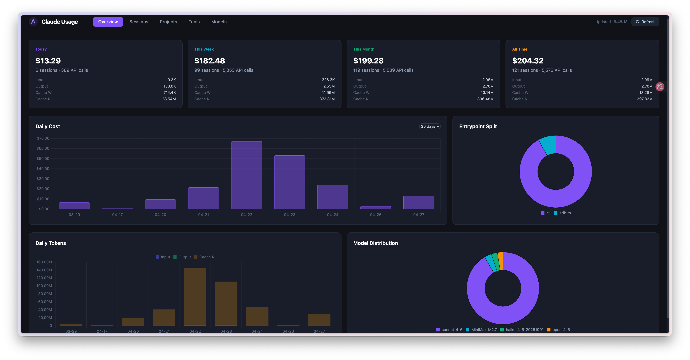
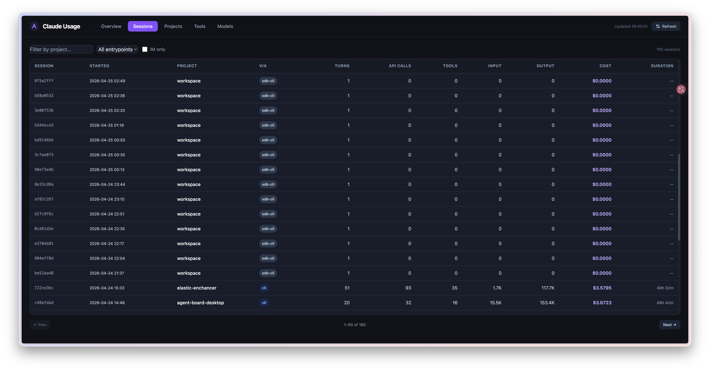
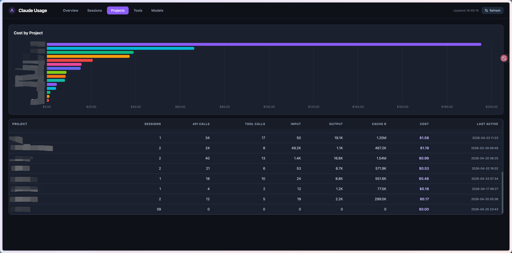
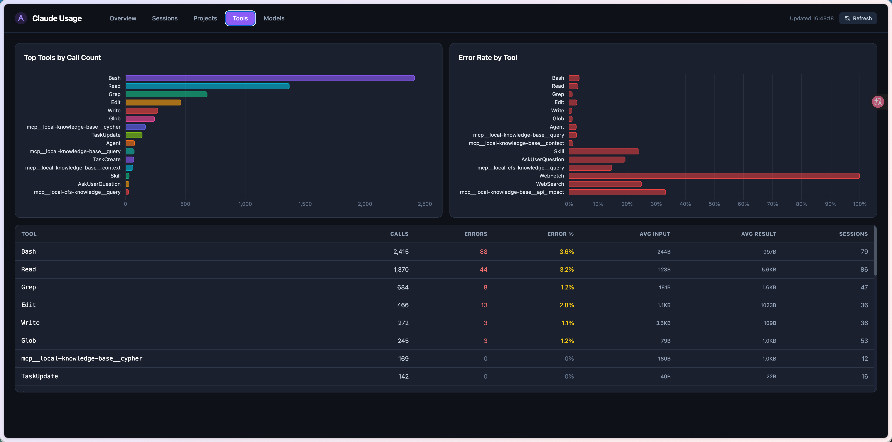
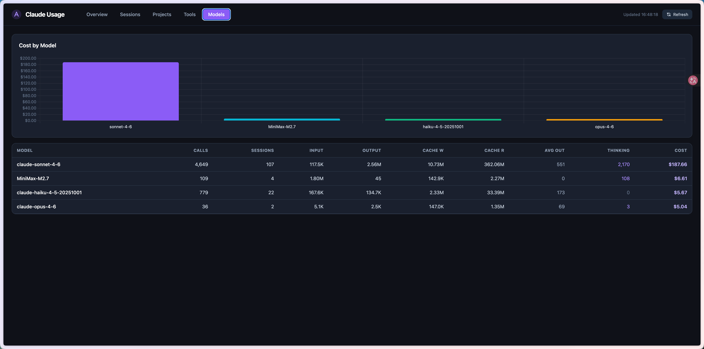

# Claude Token Tracker


> [English](README.md)

自动追踪 Claude Code 的 token 用量和费用，数据存储在本地 SQLite 数据库中，并提供一个 Web 看板供查阅分析。

## 效果截图











## 前置条件

- 已安装并配置 [Claude Code](https://claude.ai/code)
- Python 3.7+ —— 不写死任何解释器路径：hook 启动器在运行时从 `PATH` 中挑一个
  可用的解释器，找不到会明确报错
- Flask：`pip3 install flask`

## 安装

```bash
git clone https://github.com/xiaohaoxing/claude-token-tracker
cd claude-token-tracker
chmod +x install.sh
./install.sh
```

安装脚本会：
1. 在 `PATH` 中找到一个可用的 Python 3，并检查/安装 Flask
2. 在 `~/.claude/settings.json` 中注册一个 **Stop hook**，每次 Claude Code 会话结束后自动触发
3. 将 `~/.claude/projects/` 中已有的历史会话一次性导入数据库

注册的命令是一个便携启动器（`hook.sh`），而不是写死的解释器路径，
因此在换机器、升级 Python、切换包管理器后依然可用。

安装完成后，新会话会自动被追踪，无需手动操作。

安装脚本支持以下选项：

| 选项 | 作用 |
|------|------|
| `--start` | 直接在后台启动看板，不再询问 |
| `--no-start` | 从不启动（脚本化 / CI 安装） |
| `--port N` | 看板端口（默认 5001，也可用 `CLAUDE_TRACKER_PORT`） |

安装结束时会打印看板地址、当前是否已在运行；在交互式终端里还会询问是否
直接帮你启动。后台启动的看板日志在 `~/.claude/token-tracker/dashboard.log`，
PID 写在 `~/.claude/token-tracker/dashboard.pid`。

## 升级

已经装过了？升级只有一条命令：

```bash
cd claude-token-tracker
git pull
./install.sh
```

安装脚本可以反复执行，会自动完成所有事情：

1. 把 hook 注册迁移到当前的便携启动器（`python3 …/tracker.py` → `sh …/hook.sh`），
   并移除旧条目 —— 移除内容会打印出来，不会静默改动你的配置
2. 重新探测可用的 Python 3
3. 重新读取 `~/.claude/projects/` 下的全部 transcript。这同时会**修复历史会话**：
   旧版本会把一个会话的 token 统计成约 2 倍，重新导入会重新计算

不需要手工迁移任何东西 —— 新增的数据库表会在工具（hook / 命令行 / 看板）
第一次运行时自动创建。

注意事项：

- 本地有未提交改动？先 `git stash && git pull && ./install.sh`
- 不是 `git clone` 而是下载 ZIP 安装的？下载新 ZIP 后在新目录里执行
  `./install.sh` —— 即使路径变了，旧 hook 也会被移除
- 升级后可以这样确认：

```bash
python3 tracker.py --catch-up   # 输出这次补进来的会话数
python3 stats.py today          # 查看今天的用量
```

## 排查问题

工具的运行日志都在 `~/.claude/token-tracker/logs/` 下：`tracker.log` 记录 hook 和
命令行，`dashboard.log` 记录看板服务（包含未捕获的请求异常）。

一条命令就能把当前状态整理成可以直接发给我们的报告：

```bash
sh hook.sh --doctor                                   # 直接打印
sh hook.sh --doctor --out ~/Desktop/report.txt         # 保存成文件
```

即使出问题的就是 Python 本身，`--doctor` 依然可用 —— 这种情况下 `hook.sh` 会退化成
纯 shell 的环境报告。报告里**不包含任何 prompt、消息、transcript 内容或密钥**，
只有版本、文件/schema 状态、计数和日志行。

它能帮你定位：

| 现象 | 看报告中哪一节 |
|---|---|
| 完全没有追踪记录 | `Hook registration`、`Activity`（最后一次 hook、错误数） |
| 看板返回 500 | `Database`（缺哪些列）、`dashboard.log` 尾部 |
| 提示 "unsupported Python" | `Runtime`，以及 `hook.sh` 列出的解释器 |
| 数据不更新 | `Database`（最新会话时间）、`last catch-up`、`Activity` |

## 启动 Web 看板

```bash
python3 server.py          # → http://localhost:5001
python3 server.py 8080     # 自定义端口
```

同一局域网内的其他设备也可访问：`http://<你的局域网IP>:5001`

**看板页签说明：**

| 页签 | 内容 |
|------|------|
| 总览 | 今日 / 本周 / 本月 / 累计费用卡片，每日费用折线图，token 分类堆叠图，入口和模型分布 |
| 会话 | 完整会话列表，支持搜索和筛选；点击任意行可查看该会话每次 API 调用的 token 明细 |
| 项目 | 按项目目录汇总的费用和 token 用量 |
| 工具 | 各工具的调用次数、报错率、平均输入/输出大小 |
| 模型 | 各模型的 token 用量和费用占比 |

## 新会话什么时候出现？

数据通过 **Stop hook** 写入，即每次 Claude Code 完成一条响应后触发。

由于 hook 是"尽力而为"的（headless/SDK 会话可能根本不触发它，而且它可能在
本轮 transcript 落盘之前就执行了），追踪器还有一个 **catch-up 兜底**：重新扫描
`~/.claude/projects/`，把新增或有变化的 transcript 补进来：

- 每次被追踪的对话轮结束后（有节流，最快约 1 分钟一次）
- 看板服务运行期间每 5 分钟一次
- 也可以手动触发：

```bash
python3 tracker.py --catch-up                     # 只处理新增/变化的文件
python3 tracker.py --backfill ~/.claude/projects/ # 全量重读
```

两者都可重复执行（upsert + `INSERT OR IGNORE`），不会产生重复数据。
如需在看板运行期间关闭兜底，可设置 `CLAUDE_TRACKER_NO_CATCHUP=1`。

## IM 会话标记

如果你使用 [claude-to-im](https://github.com/anthropics/claude-to-im) 通过飞书、Telegram 等 IM 工具访问 Claude，来自 IM 的会话会在「会话」页签中自动显示 **IM** 标签。

无需任何额外配置，追踪器会自动检测 claude-to-im 注入的 `CTI_RUNTIME` 环境变量。

> 通过 `--backfill` 补录的历史会话无法追加 IM 标记，因为历史会话的运行时环境已不可用。

## 命令行快捷查询

不想打开浏览器时，可以用命令行快速查看统计：

```bash
python3 stats.py today          # 今日
python3 stats.py week           # 本周
python3 stats.py month          # 本月
python3 stats.py total          # 累计
python3 stats.py sessions       # 会话列表
python3 stats.py projects       # 项目汇总
python3 stats.py models         # 模型汇总
python3 stats.py tools          # 工具统计
python3 stats.py daily          # 每日明细
```

## 卸载

```bash
./uninstall.sh
```

仅移除 `~/.claude/settings.json` 中的 hook 注册，数据库文件 `~/.claude/token-tracker/token_stats.db` 会保留。

## 数据库路径

默认位置：`~/.claude/token-tracker/token_stats.db`

可通过环境变量自定义：

```bash
CLAUDE_TRACKER_DB=/path/to/custom.db python3 server.py
```

## 文件结构

```
claude-token-tracker/
├── tracker.py        # Stop hook 脚本 + 历史补录 / catch-up 兜底
├── hook.sh           # Stop hook 实际执行的便携启动器
├── stats.py          # 命令行查询工具
├── server.py         # Flask Web 看板
├── templates/
│   └── index.html    # 单页前端（Tailwind + Chart.js）
├── static/
│   ├── tailwind.min.js
│   └── chart.min.js
├── install.sh
└── uninstall.sh
```
